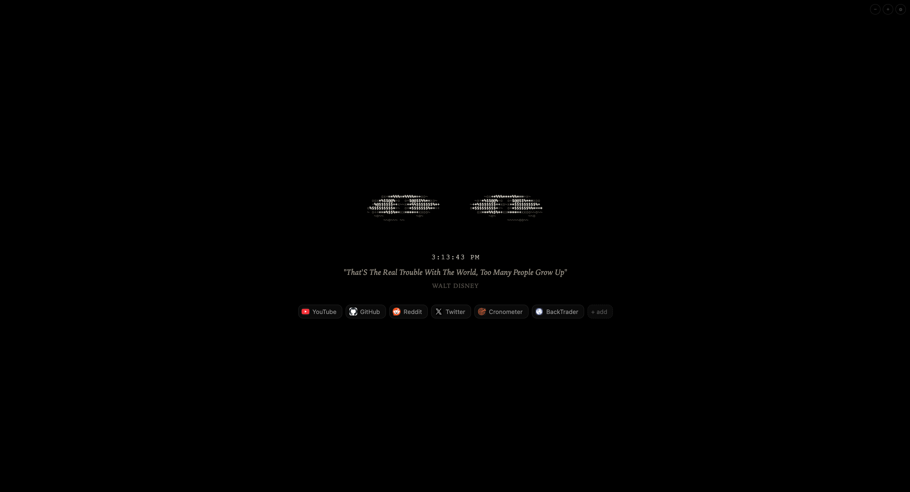

# AMOLED New Tab

A black-background new tab page for Chromium browsers, built for OLED/AMOLED screens on desktop and mobile. It shows interactive ASCII eyes that follow the cursor, a clock, an optional quote and search bar, editable shortcuts and a Chrome bookmarks drawer.



## Features

- **ASCII eyes**
  - Expression presets (Classic, Sleepy, Wide, Squint, Glare, Close-set, Wide-set) plus random-per-tab
  - Five density ramps: Classic (`· ~ o x + = * % $ @`), Minimal (`· : * # @`), Blocks (`░ ▒ ▓ █`), Binary (`0 1`), Matrix
  - Pointer/touch gaze tracking, configurable blink rate (Normal, Calm, Frequent, Off)
  - Reactions: idle drift, double-blink on click, look away on right-click, scroll reactions, sleep breathing after 35 s idle, and an optional "dizzy" wobble when you shake the mouse
  - Scales to fit narrow mobile screens
- **Search bar (optional)**: press `/` to focus; Google, DuckDuckGo, Brave, Perplexity, Bing or a custom `%s` template; bang shortcuts (`!gh`, `!yt`, `!r`, `!w`, `!m`); typed domains and URLs open directly; choose new tab or current tab
- **Bookmarks drawer**: open with the top-bar star or `b`; live search across all folders; drag a bookmark onto a shortcut chip to assign it; add or delete bookmarks inline
- **Colors**: 12 presets (Warm White, Cyber Amber, Electric Gold, Magma Orange, Crimson Red, Sunset Rose, Neon Fuchsia, Synthwave Purple, Cobalt Blue, Ice Cyan, Tokyo Mint, Terminal Green), a native color picker or a hex code; eye, glow and dim text tones are derived from the accent
- **Quotes**: random quote with copy button, can be turned off; cached and prefetched so tabs open without layout shift; offline fallbacks in `fallbacks.json`
- **Effects**: cursor/touch glow, click shockwave rings, right-click sonar pulse
- **Shortcuts and layout**: up to 8 chips with favicons, letter badges or text only; UI scale 70-200%; settings toggled off are applied before first paint
- **Storage**: `localStorage` cache for instant startup, `chrome.storage.local` as the main store, debounced `chrome.storage.sync` across devices; full settings backup/restore as JSON

## Tech stack

- Chrome Manifest V3 extension (new tab override), plain HTML, CSS and JavaScript, no build step
- Node's built-in test runner for tests
- Permissions: `storage`, `bookmarks`; host access to two quote APIs

## Getting started

### Desktop (Chrome, Brave, Edge, Arc and other Chromium browsers)

1. Clone or download this repository.
2. Open `chrome://extensions` and enable **Developer mode**.
3. Click **Load unpacked** and select the repository folder (the one with `manifest.json`).
4. Open a new tab.

### Safari (macOS)
Requires Xcode. Safari has no bookmarks API, so the Bookmarks Bridge is hidden there; everything else is identical.
1. Run `npm run build:safari`. This writes `dist/safari-extension/`, generates the Xcode wrapper in `safari/` on first run, and builds `dist/xcode-build/Build/Products/Release/AMOLED New Tab.app`.
2. The script signs with your Apple Development certificate if one is installed (sign into Xcode with an Apple ID to get one), so the extension survives Safari restarts. Without one, enable **Develop → Allow Unsigned Extensions** in Safari after every launch.
3. Open the built app once, then enable **AMOLED New Tab** in Safari → Settings → Extensions.
4. Set Safari → Settings → General → **New tabs open with** to *AMOLED New Tab*.

### Mobile

- **Extension**: in Kiwi or Lemur (Android) or Orion (iOS), open Extensions, enable Developer mode, and load the folder or a zip of it.
- **Home screen web app**: open `newtab.html` in a mobile browser and add it to the home screen.

More detail is in [docs/install.md](docs/install.md). Usage notes are in [docs/usage.md](docs/usage.md), and network and storage behavior is in [docs/privacy.md](docs/privacy.md).

### Keyboard and mouse

| Shortcut / control | Action |
| --- | --- |
| `/` | Focus the search bar (when enabled) |
| `b` | Toggle the bookmarks drawer |
| `s` or `,` | Open settings |
| `1`-`8` | Open shortcut by position |
| `Escape` | Close any drawer, modal or menu |
| Right-click | Context menu (Settings, Toggle Quote, Toggle Glow, Cycle Eyes, New Shortcut) |
| Shake the mouse | Dizzy eyes (if enabled) |

### Tests

```bash
npm test
```

## Project structure

```
manifest.json      Extension manifest
newtab.html/.css/.js   Page shell, styles and main logic (clock, quotes, search, chips, settings)
eyes-display.js    ASCII eye rendering, gaze, blink and reactions
preinit.js         Applies cached settings before first paint
storage.js         Layered storage (localStorage, chrome.storage.local/sync)
background.js      Opens the page when the toolbar icon is clicked
ascii.js, eyes.js  Helpers used by tests
fallbacks.json     Offline quotes
tests/             Node tests
docs/              Install, usage, privacy and architecture notes
icons/, scripts/   Extension icons and the script that generates them
```

## Status

Active (version 1.4.0).

## License

MIT. See [LICENSE](LICENSE).
